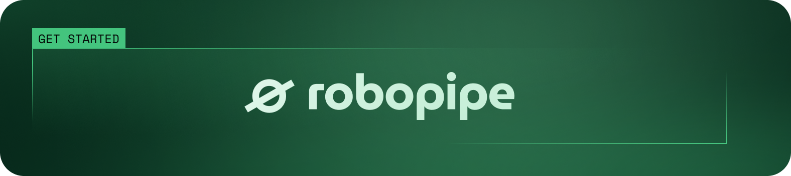

<p align="center">
    
</p>

# Robopipe API: REST and WebSocket API for Luxonis OAK cameras, edge AI inference and PLCs

**Robopipe API is an open-source Python service that connects Luxonis OAK cameras and industrial controllers (PLCs) through simple REST and WebSocket APIs. It runs AI inference on the camera and sends the results to your production line.**

Robopipe API is the edge part of [Robopipe](https://robopipe.io/en), an industrial machine vision platform for AI quality control in manufacturing. Use it from any programming language to read images, run neural networks for visual inspection and switch PLC outputs. It runs on the Robopipe controller and on any Unix-based computer. Inference runs locally, so the system works offline and product images stay in the plant.

## Features

- **Camera management.** List, start, stop and restart Luxonis OAK cameras, read camera statistics and control the IR projector. The API finds cameras automatically, and clients find the API through mDNS and UDP discovery.
- **Image capture.** Get a still JPEG image from any camera sensor with one HTTP request.
- **Live video.** Stream video with low latency over WebRTC or over a WebSocket relay to many clients at the same time.
- **Edge AI inference.** Load a neural network onto the camera and receive detections (bounding boxes and segmentation) over a WebSocket.
- **Sensor configuration.** Configure RGB, stereo and depth sensors and camera controls at runtime.
- **Rolling recording.** Keep the most recent video of each camera on disk and download it as one WebM file.
- **PLC inputs and outputs.** Read and write digital inputs, digital outputs, relay outputs, analog inputs and outputs, LEDs and Modbus registers on [Unipi](https://www.unipi.technology/) controllers. The configuration supports 1-Wire, TCP, serial and Modbus devices.
- **OpenAPI documentation.** Swagger UI at `/docs` and the OpenAPI specification at `/openapi.json`.

## How Robopipe API fits into Robopipe

| Part | What it does | Where it runs |
| --- | --- | --- |
| **[Robopipe Studio](https://github.com/Robopipe/Studio)** | Capture, labelling, training and deployment of AI models | Server or cloud, used in a web browser |
| **[Robopipe API](https://github.com/Robopipe/API)** (this repository) | REST and WebSocket API for cameras, AI inference and PLC inputs and outputs | Robopipe controller or any Unix-based computer |
| **[Robopipe OS](https://github.com/Robopipe/OS)** | Operating system image with Robopipe API preinstalled | Robopipe controller (based on Unipi Patron) |
| **[Luxonis OAK cameras](https://www.luxonis.com/)** | Image capture and on-device neural network inference | Above the production line |

Robopipe Studio uses this API to stream video, capture training images and deploy trained models to the cameras. You can also use the API directly, without Studio.

## Quick start

### On a Robopipe controller

Robopipe OS has the API preinstalled. Connect the controller and the camera, then open `http://robopipe-<id>.local` in your browser. The page shows `Hello from Robopipe API!`. Read the [setup guide](https://robopipe.gitbook.io/doc/getting-started/connection) for the wiring and the first steps.

### On your own computer

Prerequisites: a Unix-based computer, Python 3.11 or higher, Git and a Luxonis OAK camera.

1. Clone the repository and install the dependencies:

   ```bash
   git clone https://github.com/Robopipe/API.git
   cd API
   python3 -m venv .venv
   source .venv/bin/activate
   pip install -r requirements.txt
   ```

2. Create the environment file:

   ```bash
   cp .env.example .env
   ```

   `CONTROLLER_CONFIG` is necessary only on a Unipi controller. To use a different environment file, set `ROBOPIPE_API_ENV=/path/to/.env`.

3. Start the API:

   ```bash
   python3 -m robopipe_api
   ```

4. Check that the API runs and lists your cameras:

   ```bash
   curl http://localhost:8080/
   curl http://localhost:8080/cameras
   ```

5. Open the Swagger UI at [localhost:8080/docs](http://localhost:8080/docs).

### Example: capture an image in Python

```python
import requests

API_BASE = "http://robopipe-1.local"  # or http://localhost:8080

mxid = requests.get(f"{API_BASE}/cameras").json()[0]["mxid"]

# The first stream is usually CAM_A, the RGB sensor
stream = requests.get(f"{API_BASE}/cameras/{mxid}/streams").json()[0]
if not stream["active"]:
    requests.post(f"{API_BASE}/cameras/{mxid}/streams/{stream['name']}/")

image = requests.get(f"{API_BASE}/cameras/{mxid}/streams/{stream['name']}/still")
open("image.jpg", "wb").write(image.content)
```

The [Hello world guide](https://robopipe.gitbook.io/doc/getting-started/hello-world) continues with labelling, training and deployment of a model. The [capsule counting example](https://robopipe.gitbook.io/doc/examples/capsule-counting) shows a full use case.

### Build a Python package

```bash
pip install build
python -m build --wheel
```

### FFmpeg WebAssembly setup

The browser stream pages need FFmpeg WebAssembly files. Download [@ffmpeg/core](https://www.jsdelivr.com/package/npm/@ffmpeg/core) into `robopipe_api/static/core` and [@ffmpeg/ffmpeg](https://www.jsdelivr.com/package/npm/@ffmpeg/ffmpeg) into `robopipe_api/static/ffmpeg`.

## Documentation

- [Robopipe documentation](https://robopipe.gitbook.io/doc): setup, controller inputs and outputs, examples
- REST API and WebSocket API reference: source in [`docs/api`](docs/api)
- Supported Luxonis cameras: [`docs/other/supported-devices.md`](docs/other/supported-devices.md)

## Robopipe as an alternative to Roboflow, Cognex and Keyence

Robopipe is an alternative to Roboflow, Cognex and Keyence for AI visual inspection on production lines. Roboflow is a developer platform. Cognex and Keyence make rule-based vision systems that are bought as capital equipment. Robopipe delivers camera, controller, deep-learning model and support as one system. Read the comparisons: [Roboflow alternatives](https://robopipe.io/en/blog/roboflow-alternatives-in-2026-an-honest-comparison-for-manufacturing-teams), [Cognex alternatives](https://robopipe.io/en/blog/cognex-alternatives-in-2026-an-honest-comparison-for-production-lines) and [Keyence alternatives](https://robopipe.io/en/blog/keyence-alternatives-for-machine-vision-an-honest-comparison-for-2026).

## Use cases

- [Food processing](https://robopipe.io/en/industries#food): defects, foreign objects and portion checks
- [Pharma and healthcare](https://robopipe.io/en/industries#pharma): fill, closure and label verification
- [Retail and e-commerce](https://robopipe.io/en/industries#retail): automated product tagging
- [Logistics](https://robopipe.io/en/industries#logistics): safety hazards and movement statistics

See the [case studies](https://robopipe.io/en/case-studies) and the [Robopipe blog](https://robopipe.io/en/blog).

## Feedback and community

Open a [GitHub issue](https://github.com/Robopipe/API/issues/new) for bugs, improvement ideas, documentation or developer experience. Join the [Robopipe subreddit](https://www.reddit.com/r/robopipe/) to share your apps and ask questions.

## License

Robopipe API is open source under the [MIT License](LICENSE).

## Contact

- Website: [robopipe.io](https://robopipe.io/en) ([česky](https://robopipe.io/cs))
- Book a demo or ask a question: [robopipe.io/en/contact](https://robopipe.io/en/contact)

Robopipe is developed by Robopipe s.r.o., Prague, Czech Republic.
